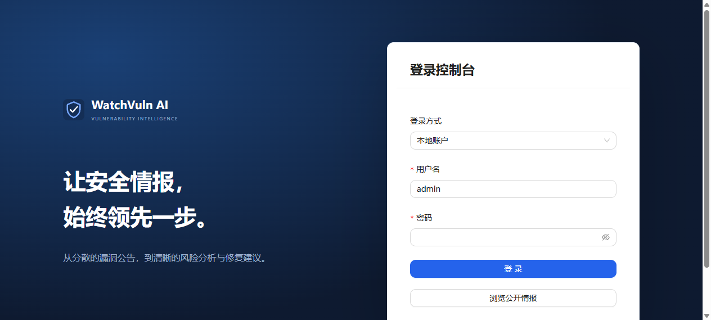
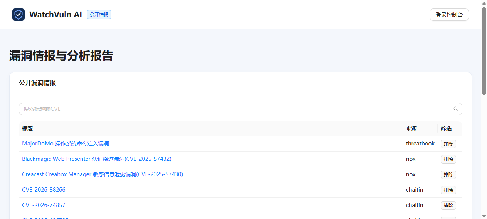
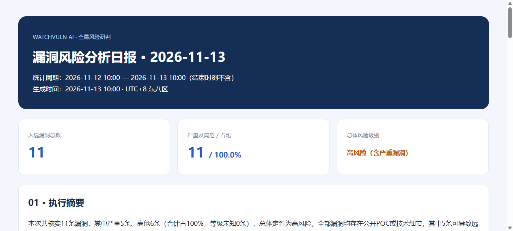

# WatchVuln AI

漏洞情报采集、筛选、AI 分析与通知平台。后端采用 Go / Gin，前端采用 React / TypeScript / Ant Design，默认使用 SQLite，提供 PostgreSQL 适配与旧版 CLI 兼容插件。

## 界面预览

以下截图来自实际部署的公开界面，仅供功能与布局参考；不同版本、权限和数据下显示内容可能不同。

### 登录



登录页面仅负责身份认证；开启公开访问后，提供独立的公开情报入口，不在登录表单中嵌套列表。

### 公开情报



### AI 风险报告



## 功能

- **漏洞情报**：搜索、筛选、手动通过/排除、历史重新标记、详情前后切换及后台手动推送。
- **采集配置**：多来源、代理、TLS 配置、采集间隔、自定义每日时段与跨午夜窗口；手动采集不受定时时段限制。
- **名单规则**：按标题、标签、描述、修复方案匹配普通关键词或 Go RE2 正则；命中原因显示名单名称，黑名单优先。
- **源状态**：只读探测可用性、结果数、耗时和错误，不入库或推送。
- **AI 漏洞分析**：影响范围、风险、验证思路及修改方案独立保存，不覆盖来源修复方案；推送卡片只展示影响范围和风险，其他内容通过详情访问。
- **AI 报告**：日报、周报与自定义日期报告，东八区展示，包含确定性统计图表、组件分类和风险提示，后台生成且支持取消。
- **通知**：飞书交互卡片、钉钉 actionCard 及其他渠道；失败记录重试，最近任务集中展示。
- **权限**：本地账户、LDAP、OIDC、飞书及钉钉认证；SSO 源位于用户权限。管理员功能与公开只读接口分离。

> AI 输出仅供辅助研判，需结合实际资产与厂商公告复核。图表统计不代表实际资产暴露量。使用 AI 会消耗服务商 Token。

## Docker 快速部署

需要 Docker Engine 与 Docker Compose 插件。项目使用多阶段构建，构建时需要访问 npm、Go 模块和基础镜像仓库。

```bash
docker compose up -d --build
docker compose ps
docker compose logs --tail=100 watchvuln
```

访问 `http://服务器地址:18080`，首次打开按页面引导选择数据库并创建管理员。**没有预置通用管理员密码，请自行设置强密码。**

默认配置：

| 项目 | 默认值 |
| --- | --- |
| 端口 | `18080` |
| 数据库 | SQLite |
| 容器数据目录 | `/app/data` |
| 持久化卷 | Compose 中的 `watchvuln_data`（实际名称通常含项目名前缀） |
| 健康检查 | `/api/status` |
| 进程用户 | 非 root |

初始化后，空漏洞库自动执行一次基线采集，仅发送汇总、不逐条刷屏，也不批量调用 AI。采集范围受来源能力、页数与超时限制，并非无限回溯全部历史。后续新增记录按配置筛选和推送。

### PostgreSQL（可选）

PostgreSQL 支持代码保留，`docker-compose.yaml` 中的服务与数据卷示例默认注释。需要时取消相关注释、配置强密码，并在初始化页面选择 PostgreSQL；连接串中的主机应使用 Compose 服务名，例如 `postgres`。**不要将已有 SQLite 数据目录直接当作 PostgreSQL 数据迁移。** Web 平台不支持直接使用旧版 MySQL 数据库。

### 数据持久化与升级

```bash
# 停止服务，不删除卷
docker compose stop

# 重建并启动，复用原持久化卷
docker compose up -d --build
```

升级前先停服备份完整数据目录/数据卷，包含数据库、初始化配置及上传历史文件。不要执行 `docker compose down -v` 或删除数据卷，除非明确准备销毁数据。数据库连接信息与服务密钥可能位于运行数据中，应限制访问且不得提交到仓库。

## 配置指南

### 页面导航

- 漏洞情报：漏洞列表、黑名单、白名单、源状态、采集配置。
- AI报告：分析报告、定时报告。
- 通知服务：渠道配置与通知记录。
- 用户权限：用户管理、SSO源。
- 系统设置：访问设置、AI设置。

### AI 设置

在 **系统设置 → AI设置** 配置启用状态、服务商、API 地址、Key、模型、单次请求超时和失败重试次数。提供 DeepSeek、智谱 GLM、OpenAI 和自定义 OpenAI 兼容接口预设；模型必须是账号实际开通的 ID。地址填写到服务商 API 前缀，不要包含 `/chat/completions`。

采集分析、手动分析及报告共用该配置。切换预设会填入地址与推荐模型，不会替你申请密钥；升级不会主动替换已有密钥。界面预设不等同于已对所有服务商及所有模型完成联网兼容验收。

### 筛选与推送

- “未通过上游高价值筛选”表示未通过本项目的来源适配器策略，不是 AI 判断。可在采集配置中关闭这层筛选，黑白名单与去重仍生效。
- 长亭按高危/严重判断，不再要求中文标题；中文摘要为空时回退英文原文。
- “重新标记”按已保存规则重算历史数据，可能覆盖人工通过/排除，不触发 AI 或通知。
- 自动采集只推送通过记录。开启 AI 补充时，符合条件且缺少来源方案的新增漏洞先分析再推送，AI 失败后按原内容降级推送。
- 管理员手动推送支持通过及排除记录；通过记录开启 AI 时先分析，排除记录直接推送且不改变筛选状态。
- 再采集已有记录可补齐缺失字段，不重复视作新增，不覆盖已有人工/AI 内容。

### 公开访问与详情链接

在 **系统设置 → 访问设置** 配置公开访问 URL 和情报/报告权限。

- `/`：登录控制台。
- `/public`：独立只读公开门户；匿名访问需要管理员开启公开访问。
- `/vulnerabilities/<id>`：漏洞详情，遵循访问权限配置。

通知接收者需要能够访问公开访问 URL。`127.0.0.1` 仅指接收者自己的设备，不适合作为多人访问链接。公网部署应通过可信反向代理使用 HTTPS，并限制管理入口访问。

### 时间与记录保留

报告正文时间展示为 UTC+8；调度使用配置的时区。开始生成时间表示任务开始时间而非完成时间，服务恢复后可能补执行当天未生成的任务。

通知记录和 AI 报告默认保留 **7 天**，旧配置有一次性迁移逻辑；启用新版前应备份历史数据。可分别配置保留天数，`0` 为永久保留；报告删除会同时删除其生成日志与关联投递记录。通知清理保护仍待投递或仍可重试的记录。

## 内置来源

| 标识 | 名称 |
| --- | --- |
| `avd` | 阿里云漏洞库 |
| `nox` | 奇安信威胁情报（兼容旧别名 `ti`） |
| `oscs` | OSCS 情报 |
| `threatbook` | 微步情报 |
| `seebug` | Seebug |
| `struts2` | Struts2 安全公告 |
| `kev` | 已利用漏洞目录 |
| `venustech` | 启明星辰漏洞通告 |
| `chaitin` | 长亭漏洞库 |

各来源接口、字段、可用性和访问政策可能变化。遇到验证码或访问验证时，不应假定登录即可解决，也不应绕过访问限制；可暂时禁用该源并使用其他来源。

## 源码构建与验证

建议使用与 `Dockerfile` 一致的 **Go 1.24、Node.js 22**。前端使用 npm 锁文件安装。

```bash
npm --prefix frontend ci
npm --prefix frontend run build
go build -o watchvuln .
./watchvuln web
```

Windows 编译时可将输出命名为 `watchvuln.exe`。默认无参数同样启动 Web 服务。

| 环境变量 | 默认值 | 含义 |
| --- | --- | --- |
| `WATCHVULN_ADDR` | `:18080` | 监听地址 |
| `WATCHVULN_DATA` | `data` | 运行数据目录 |
| `WATCHVULN_ASSETS` | `frontend/dist` | 前端构建资源 |

```bash
# 平台及兼容插件回归
go test ./internal/platform ./plugins/legacy/ctrl ./plugins/legacy/push

# 编译全部包及测试，但不执行联网采集测试
go test ./... -run '^$'

# 静态检查
go vet ./internal/platform
```

`go test ./...` 包含实际联网采集测试，可能受验证码、限速、接口变化影响；不要将其视作纯离线测试。渠道的“测试”操作会真实发送消息，执行前应确认。

## 旧版兼容插件

旧 CLI、Ent 存储和推送实现集中在 `plugins/legacy/`，不是动态加载插件。共享采集器与工具在 `internal/grab/`、`internal/util/`。

```bash
./watchvuln plugin legacy --help
./watchvuln plugin legacy -c config.example.yaml
```

旧参数入口继续兼容。`config.example.yaml`、[CONFIG.md](CONFIG.md) 的文件配置说明主要用于 legacy 模式；**Web 配置存储于平台数据库，不通过该 YAML 自动导入**。旧 MySQL/Ent 表、历史推送状态及旧 Webhook 报文与新平台并不等价，不能只替换连接串完成迁移。

## 仓库与数据安全

- 源码、依赖清单、部署配置与文档应纳入版本控制。
- 不提交密钥、数据库、运行日志、临时发布脚本、可执行文件、`node_modules`、`dist` 或构建缓存。
- 不在截图中暴露密钥、内部地址、账户资料或敏感漏洞信息；当前文档截图仅展示公开内容。
- 清理本地调试环境不得删除业务数据卷、备份、`.codebuddy` 或无关项目资源。
- 外部 AI coding 协作规范见 [Agent.MD](Agent.MD)。

## 许可证

本项目沿用 [MIT License](LICENSE)。
